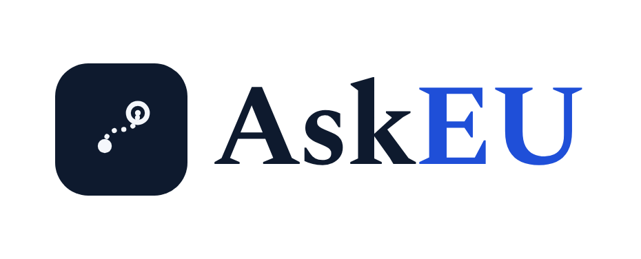

# AskEU brand assets

Official AskEU logos, colours and images.

  <picture>
    <source media="(prefers-color-scheme: dark)" srcset="askeu-logo-white.png">
    
  </picture>

## Files

| File | What it is | Use it for |
|---|---|---|
| [askeu-logo.png](askeu-logo.png) | Full logo, dark text, transparent background | Light backgrounds: documents, slides, partner pages |
| [askeu-logo-white.png](askeu-logo-white.png) | Full logo, white text, transparent background | Dark backgrounds |
| [askeu-symbol.svg](askeu-symbol.svg) | Symbol only, vector | Small spaces, app and favicon use, print |
| [askeu-avatar-512.png](askeu-avatar-512.png) | Symbol, 512 x 512 px | Profile pictures and avatars |
| [askeu-social-preview.png](askeu-social-preview.png) | Logo and tagline, 1280 x 640 px | Link previews and social media |

The avatar and the social preview are made directly from the logo files above.

## Colours

| Colour | Hex | Where |
|---|---|---|
| Ink | `#0E1A2E` | "Ask" in the logo, symbol background, text |
| AskEU blue | `#1F4FD8` | "EU" in the logo, accent |
| Light background | `#F4F7FB` | Page background, marks inside the symbol |
| Blue on dark | `#9DB4FF` | "EU" in the logo on dark backgrounds |
| White | `#FFFFFF` | "Ask" in the logo on dark backgrounds |

## Fonts

- Headings: **Spectral**
- Text: **Onest**

Both are published by their authors under the SIL Open Font License 1.1 and are available on Google Fonts. They are not included in this repository.

## Writing the name

- Write **AskEU**, one word, with a capital A and capital EU.
- Not "Ask EU", "Askeu", "ASKEU" or "AskEu".
- The website is **ask.eu.com**, always in lower case.

## Using the logo

Use the logo as supplied. Do not change the colours, stretch it, rotate it or add effects, and keep clear space around it. If you need a format that is not here, write to hello@ask.eu.com.

## Licence

All rights reserved. See [LICENSE](LICENSE). You may use these files to refer to AskEU, for example in articles or partner listings, as long as you do not change them or suggest an endorsement that does not exist.
